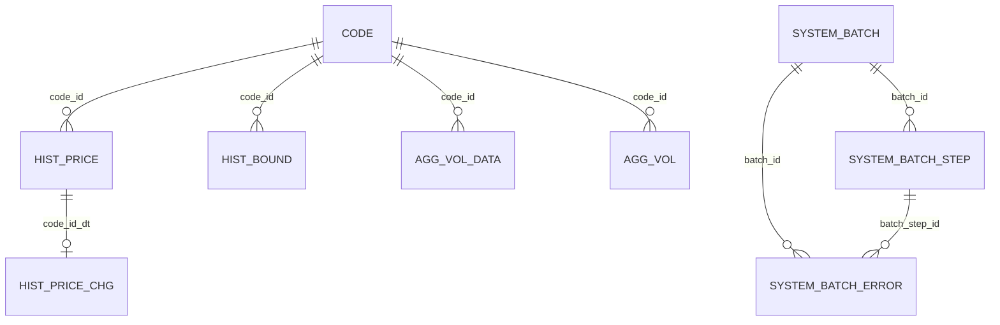
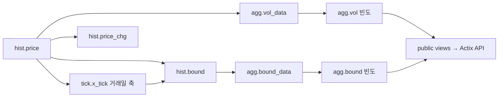

# SQL·테이블 구조 | 시세를 기간별 비교 데이터로 가공

SQL의 목적은 원천 시세를 화면에서 비교 가능한 값으로 바꾸는 것입니다. 아래는 보존된 DDL과 실제 Rust CALL·API DAO를 대조한 구조이며, 운영 DB에 접속해 덤프한 자료가 아닙니다.

## 1. 테이블을 역할별로 나누기

| 영역 | 주요 테이블·키 | 역할 |
| --- | --- | --- |
| 종목 | `code`, `code_detail`, `code_state` | 종목 identity·상세·상장 상태 |
| 원천 시계열 | `hist.price(code_id, dt)` | 일별 OHLCV, 날짜 RANGE 파티션 |
| 파생값 | `hist.price_chg(code_id, dt)` | 가격·전거래량 변화율; 원천 시세에 복합 FK |
| 거래일·방향 구간 | `tick.x_tick(exchange, dt)`, `hist.bound(code_id, line, p1x)` | 저장된 시세에서 유도한 거래소별 거래일 축과 가격 종류별 연속 방향 구간 |
| 통계 | `agg.vol_data → agg.vol`, `agg.bound_data → agg.bound` | 연도별 기간 집계와 연도 간 반복 빈도 |
| 실행이력 | `system.batch`, `system.batch_step` | 실행 부모와 Job/Step 시각·소요시간 |
| 실행계획·상태 | `system.batch_timer_plan`, `system.info` | 시작·종료 요청과 스케줄러 heartbeat |

DDL: [종목·시세](../batch/init/init-1.sql#L9-L128) · [bound](../batch/init/init-2-bound.sql#L14-L47) · [거래량 통계 키](../batch/init/init-7-agg_vol.sql#L13-L39) · [운영 이력 FK](../batch/init/init-0-system.sql#L2-L38).

위 선은 선언된 FK의 일부입니다. 아래의 파생 흐름과는 구분합니다. `batch_error`는 DDL이 있으나 실제 writer가 확인되지 않았습니다.

## 2. 거래일 RANK와 시계열 LAG

달력 일수에는 주말·휴장일이 들어갑니다. [거래소별 거래일에 RANK를 부여하는 함수](../batch/init/init-2-tick.x_tick.sql#L12-L42)를 [Rust Step에서 CALL](../batch/src/job/bound/step_tick.rs#L24-L29)하고 가격과 거래일 축을 결합해 구간 길이를 계산합니다.

[종목별 LAG로 전거래량 대비 변화율 계산](../batch/init/init-8-hist.price_chg.sql#L33-L74)에서는 이전 값이 없거나 0인 경우를 분리했습니다. 다만 미처리 행 필터가 윈도 함수 전에 적용되어 증분 첫 행의 기존 전일을 놓칠 수 있는 경계가 남아 있습니다.

## 3. 월·주·분기별 집계에서 연도 간 반복 빈도까지

[UNION ALL로 월·주·분기를 같은 구조에 모으고 RANK 계산](../batch/init/init-7-agg_vol.sql#L57-L109) → [CTE·sum(COUNT(*)) OVER로 연도별 상위 기간의 반복 빈도·비중과 순위를 계산](../batch/init/init-7-agg_vol.sql#L134-L241) → [공동 1위를 array_agg로 묶는 조회 view](../batch/init/init-7-agg_vol.sql#L264-L287)로 나눴습니다.

예를 들어 한 종목의 여러 해에서 특정 월이 거래량 상위에 반복되는지를 비교하는 데이터입니다. [Rust 집계 Step의 두 프로시저 호출](../batch/src/job/agg_vol/step_agg_vol.rs#L19-L31)과 [API DAO의 집계 view 조회](../site-api/src/dao/agg_vol_dao.rs#L15-L59)까지 연결되어 있습니다.

## 4. 가격 구간의 여러 관찰축을 공통 함수로

bound의 변화율·길이를 월·주·분기, min/max/avg 축으로 반복 분석합니다. [공통 PL/pgSQL 집계·윈도 순위 함수](../batch/init/init-7-agg.sql#L10-L107)를 [구간 통계 조합에서 재사용](../batch/init/init-7-agg-bound.sql#L58-L135)해 중복 SQL을 줄였습니다. 동적 열·기간을 다루는 내부 집계 함수이며 임의 사용자 SQL 실행 기능이 아닙니다.

## 5. 현재 경로와 별도 적재 실험

현재 JobBound는 upsert Step을 선택합니다. [타입 배열 UNNEST 일괄 삽입](../batch/src/job/bound/step_hist_insert.rs#L294-L357)과 [CSV 생성·flush](../batch/src/job/bound/step_bound_csv_copy.rs#L172-L228)·수동 COPY는 별도 구현·실험 경로입니다. 원래 파티션의 `TO YYYY-12-31` 경계, 증분 bound 꼬리 병합, 최근 조회 스냅샷의 OHLC 덮어쓰기에는 추가 검증이 필요합니다.
